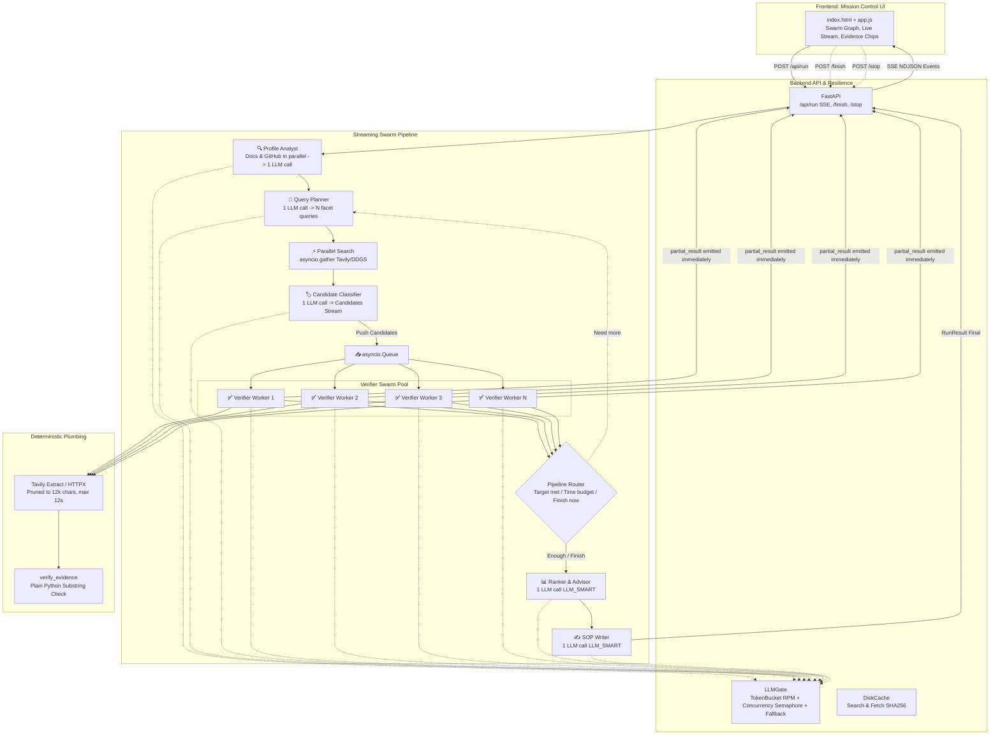

# ScholarSwarm 🎓

**AI Multi-Agent Scholarship Finder** — Built for the TetraNoodle AI Hackathon 2026

A CrewAI-powered multi-agent system that searches, verifies, and ranks real scholarship opportunities tailored to any student's profile.

## Architecture (v2 Streaming Swarm)



## Key Features (v2)

- **Parallel Streaming Pipeline**: Verification begins within seconds as candidates are found, without waiting for research to finish.
- **LLMGate with Zero-Drop Resilience**: Token-bucket RPM limiter, concurrency semaphore, automatic backoff with jitter on 429/503, and seamless failover (`LLM_FALLBACK_MODEL`). Never drops candidates on rate limits.
- **Sub-4-Minute Execution**: Down from 13+ minutes to ~3 minutes end-to-end by pruning multi-turn loops down to ~15 total LLM calls.
- **Live Swarm Mission Control UI**:
  - Interactive SVG swarm graph showing active node pulsing, worker dot illuminations, and traveling handoff pulses.
  - ChatGPT-style collapsible agent thought stream.
  - Interactive **Evidence Chips** with popovers showing verbatim official-source quotes and origin URLs.
  - Interactive **Stop** and **Finish Now** backend controls.
  - **Chaos Mode** toggle demonstrating resilience and automatic fallback live in front of evaluators.
  - Auto-generated **Gap-to-Action** board and Markdown SOP draft with 1-click copy/download.
- **Plain-Python Evidence Checking**: Zero LLM self-certification. Quotes verified via strict substring checks against exact fetched text.
- **100% Adaptable**: Zero student names or scholarships hardcoded in code. Tested against diverse profiles.

## Setup

### Prerequisites
- Python 3.11+
- API Keys (see below)

### Installation

```bash
# Clone and enter the project
cd scholarswarm

# Create virtual environment
python -m venv .venv
.venv\Scripts\activate  # Windows
# or: source .venv/bin/activate  # Linux/Mac

# Install dependencies
pip install -r requirements.txt

# Configure environment
cp .env.example .env
# Edit .env with your API keys
```

### Configuration & Credentials

ScholarSwarm supports either Google Cloud Vertex AI (enterprise service account) or Google AI Studio (API key):

| Key | Mode | Required | Description |
|-----|------|----------|-------------|
| `GOOGLE_APPLICATION_CREDENTIALS` | Vertex AI | Yes (for Vertex) | Path to service account JSON (e.g. `service_account.json`) |
| `VERTEXAI_PROJECT` | Vertex AI | Yes (for Vertex) | GCP Project ID (e.g. `ai-video-462714`) |
| `VERTEXAI_LOCATION` | Vertex AI | Optional | GCP Region (default: `us-central1`) |
| `GEMINI_API_KEY` | AI Studio | Yes (for AI Studio) | [Google AI Studio](https://aistudio.google.com/) API Key |
| `LLM_MODEL` | Both | Optional | e.g. `vertex_ai/gemini-2.5-flash` or `gemini/gemini-3.8-flash` |
| `TAVILY_API_KEY` | Search | Recommended | [Tavily](https://tavily.com/) (falls back to DuckDuckGo without it) |
| `GITHUB_TOKEN` | Enrichment | Optional | [GitHub Settings](https://github.com/settings/tokens) (raises rate limit) |

### Run Locally

```bash
# Start the FastAPI server & Swarm runner
python -m uvicorn app.main:app --host 127.0.0.1 --port 8080 --reload
# Open in your browser:
# http://127.0.0.1:8080
```

### Run Performance Report & Smoke Test

```bash
# Run headless smoke test on Profile A & Profile B:
python scripts/smoke_run.py

# Or inspect the performance report of any saved run:
python scripts/perf_report.py runs/<run_id>.json
```

### Run Quality Gates (All 4 must pass)

```bash
pytest -v
ruff check .
mypy app scripts
vulture app scripts
```

### Docker

```bash
docker build -t scholarswarm .
docker run -p 8080:8080 --env-file .env scholarswarm
```

### Deploy to Cloud Run

```bash
gcloud run deploy scholarswarm \
    --source . \
    --region asia-south1 \
    --allow-unauthenticated \
    --timeout 600 \
    --max-instances 1 \
    --memory 1Gi \
    --set-env-vars "LLM_MODEL=gemini/gemini-2.5-flash" \
    --set-secrets "GEMINI_API_KEY=gemini-api-key:latest,TAVILY_API_KEY=tavily-api-key:latest"
```

## Sources Policy

Every displayed deadline, funding amount, or requirement carries:
- A `source_url` from a real search result
- An `evidence_quote` copied verbatim from the fetched page
- A `verified` flag set by `verify_evidence()` — plain Python substring check, not LLM

If the quote cannot be verified against the page text, the field is shown as "unverified/unknown".

## License

Hackathon project — not licensed for production use.
