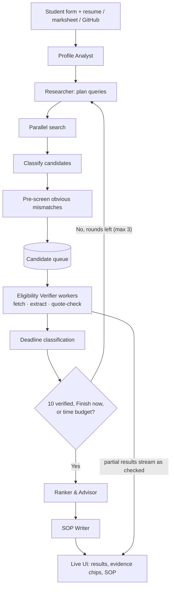

# Scholarship Star

**A team of AI agents that finds scholarships you can actually apply for, proves every claim with a source quote, and drafts your SOP.**

Built for the TetraNoodle AI Hackathon 2026 by Vamsi Siva Ganesh Seelam (Lovely Professional University, individual entry).

- **Live demo:** https://scholarship-325287784.us-central1.run.app/
- **Repository:** https://github.com/Svamsi2006/scholarship
- **Demo video:** https://drive.google.com/file/d/1ja4TKoOi8uySdd762sRJtG75kUTIrYcY/view?usp=sharing

---

## 1. The problem

Students lose time and money on scholarship search. Pages are scattered, deadlines and eligibility rules are buried deep in official sites, aggregator blogs are often out of date, and a single missed rule (citizenship, degree level, a closed cycle) wastes an application. An AI that "just answers" makes this worse, because it can sound confident and be wrong about a deadline or an amount.

## 2. What Scholarship Star does

Give it a student profile (form, resume, marksheet, GitHub). It then:

1. Builds a structured profile and lists what it could not find out (for example, citizenship).
2. Searches the live web for scholarships that fit the student's degree, field, countries and background.
3. Opens the official pages and checks eligibility, deadline and funding.
4. Keeps only claims backed by a **verbatim quote found in that scholarship's own page text**.
5. Ranks the best five, explains fit, risks and gaps, and drafts an SOP from the student's real facts.

Everything streams live in a mission-control UI, so you can watch the agents work, see failures recover, and inspect the evidence behind every result.

## 3. The agents

| Agent | Job | Tools |
| --- | --- | --- |
| **Profile Analyst** | Turns form, resume, marksheet and GitHub into a structured profile. Records gaps instead of guessing. | Document parser, OCR fallback, GitHub API |
| **Opportunity Researcher** | Plans diverse search queries once, runs them in parallel, classifies candidates. | Tavily search, DuckDuckGo fallback |
| **Eligibility Verifier** | Fetches official pages, extracts deadline, funding and requirements with quotes, and checks each quote. | Fetch tiers, ScholarRAG, evidence checker |
| **Ranker & Advisor** | Scores fit, flags risks and gaps, selects the top 5. | Verified results only |
| **SOP Writer** | Writes the Statement of Purpose from real projects, skills and academics. | Profile and chosen opportunity |

The LLM is used only where judgment is needed. Searching, fetching, GitHub pagination, date parsing, quote checking and pre-filtering are plain code, which is why runs are fast and cheap.

## 4. How it works



If fewer than 10 candidates are verified, the researcher runs another round. It is told which URLs were already tried and why they failed, so it has to look from new angles.

## 5. Why you can trust the results

- **Every claim needs a quote.** Deadlines, amounts and requirements must come with a verbatim quote from the fetched page.
- **Quotes are checked in code, not by the LLM.** Text is normalized (Unicode, smart quotes, markdown, whitespace, case), then matched exactly, then by a strict fuzzy match as a second step.
- **No cross-contamination.** A quote is checked only against its own candidate's page. A quote copied from another scholarship fails.
- **Unknown stays unknown.** If a quote can't be matched, the field is flagged `unknown`, never filled in. A scholarship is rejected only when a criterion is `not_met` with a passing quote.
- **No guessing about identity.** Citizenship and residency stay `null` with a visible gap until the student provides them.
- **Deadlines are classified:** fixed, rolling, cycle, anticipated or unknown. Only a clearly past fixed deadline with no next cycle is dropped. Unparseable dates are never treated as past.
- **Search snippets are never evidence.** They are labeled "unverified lead".
- **Evidence chips in the UI** show the quote, the source URL and the fetch time on hover.
- **Nothing is hardcoded to a student or a scholarship.** Tests check this, and three different profiles produce different queries and results.

## 6. Failure recovery (visible in the UI)

| What goes wrong | What happens |
| --- | --- |
| LLM rate limit (429) | `LLMGate` retries with exponential backoff and jitter, then falls back to another model. No candidate is dropped. |
| Search provider fails | Tavily falls back to DuckDuckGo. |
| Page blocks or times out | Fetch tiers: Tavily Extract, then `httpx` + `trafilatura`, then Jina Reader, then an unverified snippet lead. |
| Dead link (404, 410, 401, 403, 451) | Not retried, so no time is wasted. |
| Scanned PDF marksheet | Text under 50 characters triggers Gemini Vision OCR, one page at a time with bounded memory. |
| Research round finds too little | New round with exclusions and failure reasons. |
| Demo day | **Chaos mode** injects random transient failures so judges can watch the recovery live. |

## 7. Measured results

Local runs with live Vertex AI (Gemini 2.5 Flash) and Tavily, on two different students:

| Metric | Environmental Eng. → Nordic | CS/AI → US, DE, CA, UK |
| --- | --- | --- |
| Total time | 117.9 s | 86.3 s |
| First verified result | 28.9 s | 34.5 s |
| LLM calls | 27 | 15 |
| 429s / candidates dropped | 5 / 0 | 1 / 0 |
| Claims without a quote | 0 | 0 |
| Peak memory (local) | 0.40 GiB | 0.31 GiB |

The first version took over 13 minutes without finishing, made 100+ LLM calls and dropped 15 candidates to rate limits.

## 8. Tech stack

Python 3.11+, CrewAI, LiteLLM, Pydantic v2, FastAPI with NDJSON streaming, vanilla HTML/JS/CSS (no build step), Gemini 2.5 Flash via Vertex AI, Tavily and DuckDuckGo, `httpx` + `trafilatura` + `pypdf` + `pypdfium2`, in-memory ChromaDB with offline hash embeddings, GitHub REST API, Docker, Google Cloud Run.

## 9. Run it locally

```bash
python -m venv .venv
.venv\Scripts\activate          # Windows
pip install -r requirements.txt
cp .env.example .env            # then fill in your keys
python -m uvicorn app.main:app --host 127.0.0.1 --port 8080 --reload
```

Open http://127.0.0.1:8080. Use the profile modal to enter a student, or upload a resume and marksheet.

**Environment variables** (see `.env.example`): `GEMINI_API_KEY`, `TAVILY_API_KEY`, `GITHUB_TOKEN` (optional), `LLM_MODEL`, `LLM_FALLBACK_MODEL`, `LLM_CONCURRENCY`, `CHAOS_RATE`, and `VERTEXAI_PROJECT` plus a git-ignored `service_account.json` if using Vertex AI. Never commit keys.

## 10. Deploy to Google Cloud Run

```bash
gcloud run deploy scholarship --source . --region us-central1 \
  --allow-unauthenticated --timeout 600 --max-instances 1 \
  --memory 2Gi --concurrency 4
```

## 11. Tests and quality

```bash
python -m pytest -v
ruff check .
mypy app scripts
vulture app scripts --min-confidence 80
```

46 tests cover evidence matching (including cross-contamination), deadline handling, citizenship gaps, rate-limit recovery, fetch retries, GitHub pagination, OCR fallback, adaptability across profiles and the pipeline controls.

## 12. Known limitations

- A matching quote proves the text is on the fetched page. It does not prove the page is the official or current source, so students should open the official site before applying.
- The pre-screen filter uses keyword rules to skip obvious mismatches. It is a speed optimization, and eligibility is still decided by the evidence checks.
- Results depend on what the search providers return, so some scholarships will be missed.
- Memory numbers are from local runs, not from Cloud Run.
- The SOP is a draft. Missing personal facts are left as `[ADD: ...]` placeholders and are never invented.

## 13. Repository layout

```
app/        agents, tasks, flow, LLMGate, models, API, tools (search, fetch, github, documents, evidence)
static/     mission-control UI (index.html, app.js, styles.css)
tests/      unit and pipeline tests, synthetic profile fixtures
scripts/    performance report
docs/       dev_log.md, architecture.md
runs/       saved run results (replay and chat context)
```
