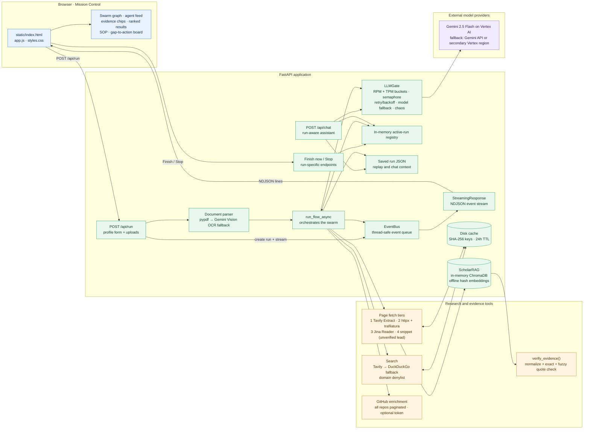
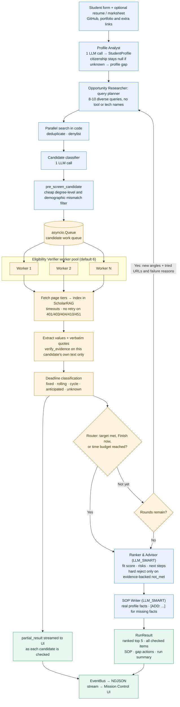
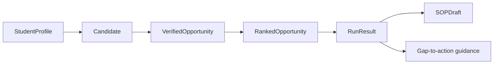

# Scholarship Star Architecture

Scholarship Star is a streaming, multi-agent scholarship research system. It turns a student's profile into sourced scholarship candidates, checks every claim against the fetched page text, ranks the suitable opportunities, and drafts an SOP grounded in the student's real facts.

> **Transport note:** the browser receives newline-delimited JSON (NDJSON) from `POST /api/run` through FastAPI's `StreamingResponse`. This is not Server-Sent Events (SSE).

## 1. System architecture



### Runtime responsibilities

- **Frontend:** collects student details and optional resume, marksheet, GitHub, LinkedIn and portfolio links. Shows progress, each agent's events, partial results, evidence chips, rankings, the gap-to-action board and the SOP draft.
- **FastAPI:** serves the static UI and exposes `/health`, `/api/run`, Finish/Stop controls, `/api/replay/{run_id}` and `/api/chat`.
- **EventBus:** numbers and timestamps every event, keeps the run's event history, and relays events to the NDJSON stream.
- **LLMGate:** every model call goes through it. It enforces request and token rate limits, a concurrency semaphore, bounded retries with exponential backoff and jitter, and fallback-model selection. `litellm.drop_params = True` keeps failover from crashing on provider-specific parameters. Retries and fallbacks are emitted as visible events and no work item is dropped on a 429.
- **ScholarRAG:** fetched pages are indexed into an ephemeral in-memory ChromaDB collection using offline hash embeddings (no model download). The verifier retrieves only the high-signal passages for deadline, award and eligibility, which shrinks verification context while keeping verbatim text available for quote checks.
- **Cache and run files:** the disk cache stores search and page results under SHA-256 filenames with a 24h expiry. Saved run JSON supports replay and follow-up chat.

## 2. Streaming swarm pipeline



### Agent roles

| Agent | Responsibility | Main tools |
| --- | --- | --- |
| Profile Analyst | Builds the structured profile from the form, parsed documents and GitHub | Document parser, OCR fallback, GitHub API |
| Opportunity Researcher | Plans queries once, searches in parallel, classifies candidates | Tavily, DuckDuckGo |
| Eligibility Verifier | Fetches official pages, extracts values with quotes, checks each quote | Fetch tiers, ScholarRAG, `verify_evidence` |
| Ranker & Advisor | Scores fit, flags risks and gaps, picks the top 5 | Verified results only |
| SOP Writer | Drafts an SOP from real profile facts | Profile, verified opportunity |

The LLM is called only where judgment is needed. Searching, fetching, GitHub pagination, quote checking, date parsing and the pre-filter run as plain code.

### Feedback and stopping logic

The router counts usable results while verifier workers are still running. The run moves to ranking when the target (default 10 verified) is met, the user clicks **Finish now**, or the time budget is reached. If the target is not met and rounds remain (max 3), the planner receives the URLs already tried and why they failed, and must search from new angles.

## 3. Typed data contracts



- `StudentProfile`: form fields plus normalized education, skills, projects, achievements, test scores, links and `gaps`. `citizenship` and `residency_status` are `null` when unknown, and unknown citizenship adds a profile gap. It is never guessed from target countries.
- `Candidate`: opportunity identity, source URL, institution and country, type, discovery query.
- `VerifiedOpportunity`: status, official URL, deadline with `deadline_type`, funding, eligibility checks (`met` / `not_met` / `unknown`), each with quote and match method, plus missing information.
- `RankedOpportunity`: fit score, score breakdown, risks, rationale, readiness, next actions.
- `RunResult`: final profile, ranked list, all checked opportunities, SOP draft, gap actions, run summary.

## 4. Evidence integrity

A model's answer is never accepted as proof for a deadline, amount or requirement.

1. The verifier extracts a value plus a verbatim quote from that candidate's own fetched page text.
2. `verify_evidence()` normalizes the quote and the page text the same way: Unicode NFKC, curly quotes and dashes to ASCII, markdown syntax stripped, whitespace collapsed, case folded.
3. Stage 1 is an exact substring match on the normalized text. Stage 2, only if stage 1 fails and the quote is at least 25 characters, is a `difflib` sliding-window match at a 0.92 similarity ratio. The match method (`exact`, `fuzzy`, `none`) is stored on the field and emitted in telemetry.
4. Quotes are checked only against the candidate they came from, so a quote lifted from a different scholarship's page fails.
5. A failed check leaves the field `unknown` and surfaces the missing information. Unknown is flagged, not silently dropped.
6. A candidate is rejected for eligibility only when a criterion is `not_met` with a passing quote.
7. Deadlines are classified as fixed, rolling, cycle, anticipated or unknown. A candidate is dropped for a deadline only when it is `fixed`, the parsed date is before the reference date (Oct 22, 2026) and the page shows no sign of a next cycle. Unparseable dates are `unknown`, never "past".
8. The UI links each evidence chip to its source so students can inspect it.

This confirms the quote appears in the fetched text. It does **not** prove the source is authoritative or current, so students should open the official page before applying. Search snippets are used only as "unverified leads" and never count as evidence.

## 5. Resilience and observability

| Component | Recovery / guardrail |
| --- | --- |
| LLM requests | RPM and TPM token buckets, concurrency semaphore, retries with exponential backoff and jitter, fallback model, `drop_params` for cross-provider failover |
| Search | Tavily first, DuckDuckGo fallback, domain denylist, disk cache |
| Page fetch | Tavily Extract in small batches with per-batch timeouts, then `httpx` + `trafilatura`, then Jina Reader for JS-heavy pages, then an unverified snippet lead. No retries on 401, 403, 404, 410, 451 |
| Scanned PDFs | `pypdf` first. Under 50 characters triggers Gemini Vision OCR, one page at a time at about 108 DPI, max 5 pages, one OCR job at a time |
| GitHub | Full repo pagination, language aggregation across all repos, top 8 notable repos fetched in parallel. Failure continues with the remaining profile inputs |
| Evidence | Failed quote checks are never promoted to verified facts |
| Demo resilience | Chaos mode injects transient failures. Retries and fallbacks appear as UI events |

Events cover progress, tool calls and results, cache hits, partial results, retries, fallbacks, warnings, errors and completion. A performance report script summarizes each saved run: wall time, time to first verified result, LLM calls, 429s, dropped candidates, 4xx retries, slowest steps and peak memory.

## 6. Measured results (local runs, live Vertex AI + Tavily)

| Metric | Target | Run 1 (Environmental Engineering → Nordic) | Run 2 (CS → US/DE/CA/UK) |
| --- | --- | --- | --- |
| Wall time | under 4 min typical, 7 min cap | 117.9 s | 86.3 s |
| First verified result | under 90 s | 28.9 s | 34.5 s |
| LLM calls | 45 or fewer | 27 | 15 |
| 429s / candidates dropped | 0 dropped | 5 / 0 | 1 / 0 |
| Claims without a quote | 0 | 0 | 0 |
| Peak memory (local) | under 1.5 GiB | 0.40 GiB | 0.31 GiB |

The two runs produced different, profile-relevant top 5 lists and SOPs. Memory was measured locally, not on Cloud Run.

## 7. Running and deployment

```bash
python -m uvicorn app.main:app --host 127.0.0.1 --port 8080 --reload
```

The repository includes a `Dockerfile` and `docker-compose.yml`, and the README documents a Google Cloud Run path. Recommended settings: `--timeout 600 --max-instances 1 --memory 2Gi --concurrency 4`. Model and search credentials come from environment configuration or a service account file that is git-ignored. Secrets are never committed.
