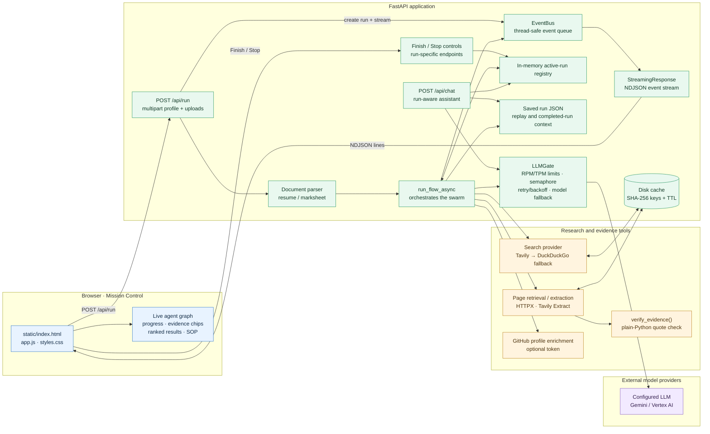
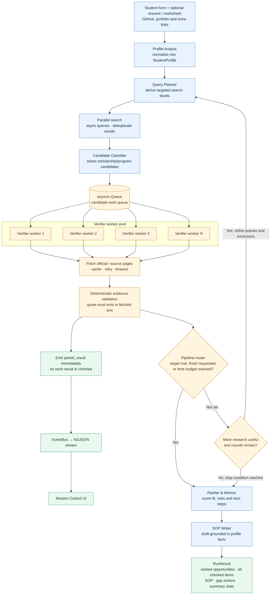
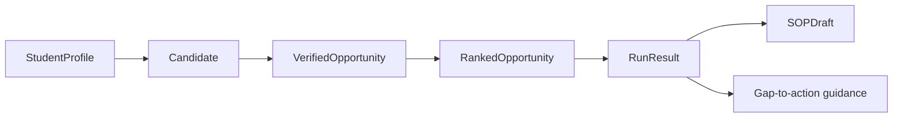

# ScholarSwarm Architecture

ScholarSwarm is a streaming, multi-agent scholarship research system. It turns a student's profile into sourced scholarship candidates, checks evidence, ranks suitable opportunities, and drafts application guidance.

> **Implementation note:** the browser receives newline-delimited JSON (NDJSON) from `POST /api/run` via FastAPI's `StreamingResponse`; this is not Server-Sent Events (SSE).

## 1. System architecture



### Runtime responsibilities

- **Frontend:** collects student details and optional resume/marksheet files; displays progress, individual agent events, partial results, evidence, rankings, gap-to-action guidance, and the SOP draft.
- **FastAPI:** serves the static UI and exposes `/health`, `/api/run`, run control endpoints, `/api/replay/{run_id}`, and `/api/chat`.
- **EventBus:** assigns event sequence numbers and timestamps, stores the event history for the run, and safely relays events to the asynchronous NDJSON stream.
- **LLMGate:** centralizes model calls, token/request rate limits, concurrency control, bounded retries with backoff, fallback-model selection, and observable retry/fallback events.
- **Cache and run files:** the disk cache stores search/fetched-page results under SHA-256-derived filenames with expiry; saved run JSON supports replay and follow-up chat context.
- **External tools:** Tavily is the preferred search backend, DuckDuckGo is the fallback, GitHub enrichment is optional, and page retrieval/extraction supplies the text used by evidence checks.

## 2. Streaming swarm pipeline



### Feedback and stopping logic

The router checks verified/usable results while verifier workers are still running. The run can move to ranking when the configured target is met, the user selects **Finish now**, or the time budget is reached. When more research is useful and rounds remain, the planner receives targeted feedback and exclusions to search again. The UI can receive partial results before the full run is complete.

## 3. Typed data contracts

The principal Pydantic models carry the information between stages:



- `StudentProfile` combines form fields with normalized education, skills, projects, achievements, test scores, links, and identified gaps.
- `Candidate` records the opportunity identity, source URL, country/institution information, type, and discovery query.
- `VerifiedOpportunity` tracks status, official URL, deadline/funding evidence, eligibility checks, application guidance, and missing information.
- `RankedOpportunity` adds the fit score, score breakdown, risks, rationale, readiness, and next actions.
- `RunResult` combines the final profile, ranked list, all checked opportunities, optional SOP draft, gap actions, and run summary.

## 4. Evidence integrity

For deadlines, funding amounts, and requirements, a model-generated answer is not accepted as proof by itself:

1. A verifier retrieves page text and extracts a candidate value plus its verbatim evidence quote.
2. `verify_evidence()` checks that the quote is present in the retrieved text using plain Python substring matching.
3. If the quote cannot be matched, the affected field is left unverified/unknown and the missing information is surfaced.
4. The UI links evidence back to its source so students can inspect the original context.

This check confirms that the quote appears in fetched text; it does **not** independently guarantee that the source is authoritative or that a scholarship page is still current. Users should open the official source before applying.

## 5. Resilience and observability

| Component | Recovery / guardrail |
| --- | --- |
| LLM requests | RPM/TPM token buckets, concurrency semaphore, bounded retries with exponential backoff and jitter, configured fallback model |
| Search | Tavily first; fall back to DuckDuckGo when unavailable or unconfigured |
| Search and fetched text | SHA-256-keyed disk cache with expiry |
| Page retrieval | Timeouts and retry/error events; unresponsive sources are not treated as verified |
| Optional GitHub enrichment | Continue with available profile inputs when enrichment fails |
| Evidence checking | Failed quote checks do not get promoted to verified facts |
| Demo resilience | Chaos mode can inject transient failures; retry and fallback actions are emitted as UI events |

Events include progress, tool calls/results, cache hits, partial results, retries, fallbacks, warnings, errors, and completion. This makes the system's behavior visible during execution instead of hiding it behind a single final response.

## 6. Running and deployment

For local development, install dependencies from `requirements.txt` and start the app with:

```bash
python -m uvicorn app.main:app --host 127.0.0.1 --port 8080 --reload
```

The repository includes a `Dockerfile` and `docker-compose.yml`, and the README documents a Google Cloud Run deployment path. Model and search credentials are supplied through environment configuration; secrets should not be committed to the repository.
